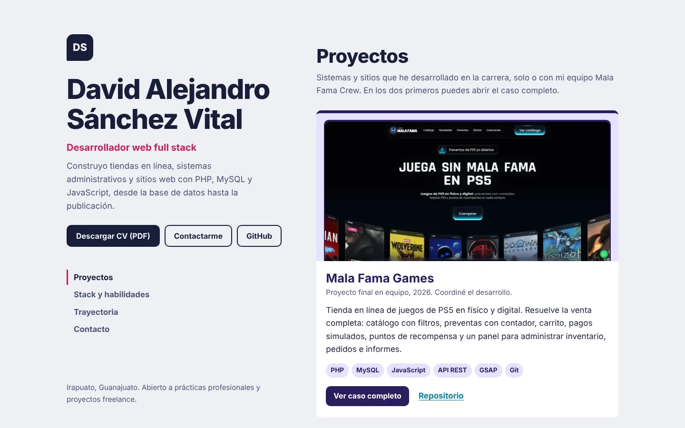
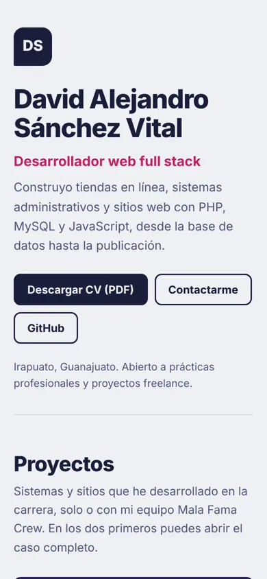
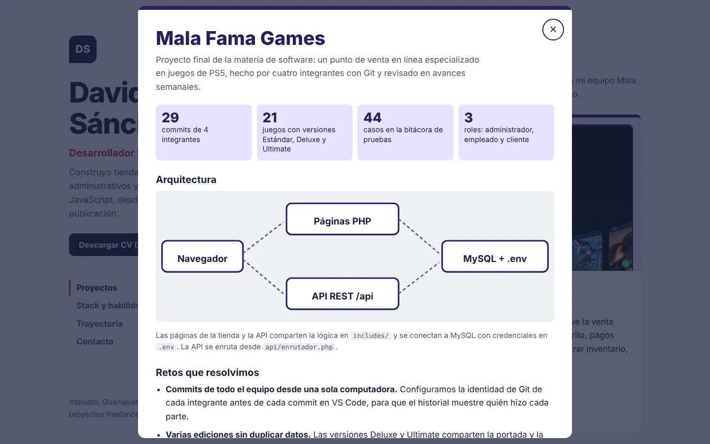

# Portafolio profesional — David Alejandro Sánchez Vital

Portafolio web individual que funciona como carta de presentación técnica ante reclutadores y clientes. Reúne mis proyectos académicos y personales, mi stack tecnológico, mi trayectoria y un formulario de contacto.

- **Sitio publicado:** https://alejandrosanch3z010-ui.github.io/portafolio/
- **Institución:** Instituto Tecnológico Superior de Irapuato (ITESI), Ingeniería en Informática
- **Materia:** Desarrollo de Aplicaciones Web, Proyecto U3
- **Docente:** Francisco Hunahpu Sahagún González

## Capturas

| Escritorio | Móvil |
|---|---|
|  |  |



## Secciones

1. **Hero:** nombre, especialización, propuesta de valor y botones para descargar el CV en PDF, ir a contacto y abrir GitHub.
2. **Proyectos:** cinco proyectos con captura, problema que resuelven, etiquetas de tecnologías, repositorio y demo cuando existe. Mala Fama Games y PeopleLink tienen una vista detallada (modal) con arquitectura, retos técnicos y métricas.
3. **Stack y habilidades:** herramientas agrupadas por área, sin barras de porcentaje.
4. **Trayectoria y formación:** línea del tiempo con formación, eventos institucionales, ferias y proyectos.
5. **Contacto:** formulario con validación en JavaScript y enlaces a correo, GitHub y LinkedIn.

## Tecnologías

- HTML5 semántico (`header`, `main`, `section`, `article`, `footer`, `nav`, `dialog`)
- CSS3 mobile-first con variables, Grid y Flexbox, sin frameworks
- JavaScript sin librerías: modales con `<dialog>`, navegación activa con `IntersectionObserver` y validación del formulario
- Imágenes en WebP (entre 20 y 135 KB cada una) con `loading="lazy"` y tamaño declarado
- Tipografías: Bricolage Grotesque y Atkinson Hyperlegible (Google Fonts)
- Publicación en GitHub Pages

## Estructura

```
portafolio/
├── index.html
├── README.md
├── assets/
│   ├── favicon.svg
│   └── img/
│       └── proyectos/   capturas de cada proyecto (.webp)
├── css/
│   └── estilos.css
├── js/
│   └── main.js
└── docs/
    ├── CV_David_Sanchez_Vital.pdf
    └── capturas/        capturas del portafolio para este README
```

## Accesibilidad y rendimiento

- Enlace para saltar al contenido y foco visible en todos los elementos interactivos.
- Textos alternativos en todas las imágenes y diagramas con `<title>`.
- Los errores del formulario se muestran después de usar el campo y se anuncian a lectores de pantalla con `aria-invalid` y `aria-describedby`.
- Respeta la preferencia de movimiento reducido del sistema.
- Sin desbordamiento horizontal en celular, tableta ni escritorio.

## Cómo verlo en local

Abre `index.html` en el navegador o usa la extensión Live Server de VS Code.

## Autor

David Alejandro Sánchez Vital — [GitHub](https://github.com/alejandrosanch3z010-ui) · alejandrosanch3z010@gmail.com
